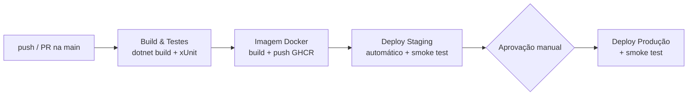

# Projeto - Cidades ESGInteligentes
## MobilidadeESG API — DevOps (CI/CD + Docker)

API RESTful em **.NET 8** para monitorar o uso de transportes sustentáveis (bicicletas, veículos elétricos, BRT, VLT, ciclovias), calcular o impacto ambiental (CO₂ evitado, energia consumida) e recompensar usuários por escolhas de baixa emissão.

Nesta fase o projeto foi preparado para um fluxo de entrega contínua: imagem Docker enxuta, orquestração com Docker Compose, pipeline no GitHub Actions com build, testes automatizados e deploy em dois ambientes (**staging** e **produção**).

**Integrante:** Gabriel Silva Alves — RM: `XXXXX`

---

## Como executar localmente com Docker

**Pré-requisitos:** Docker Desktop (ou Docker Engine + Compose v2).

```bash
# 1. Crie o arquivo de variáveis a partir do exemplo e ajuste as senhas
cp .env.example .env

# 2. Suba API + SQL Server
docker compose up --build -d

# 3. Acompanhe a subida (o SQL Server leva ~30s para ficar saudável)
docker compose ps
docker compose logs -f api

# 4. Verifique a saúde da aplicação
curl http://localhost:8080/health
```

| Recurso | URL |
|---|---|
| Swagger | http://localhost:8080 |
| Health check | http://localhost:8080/health |

Na primeira subida a API cria o schema e aplica o seed (rotas de exemplo + usuário admin). Login de teste em `POST /api/auth/login`:

```json
{ "email": "admin@mobilidade-esg.com", "senha": "Admin@123" }
```

Para derrubar o ambiente: `docker compose down` (adicione `-v` para apagar também o volume do banco).

> A senha em `DB_PASSWORD` precisa seguir a política do SQL Server (maiúscula, minúscula, número e símbolo) e não deve conter `;` nem `$`.

---

## Pipeline CI/CD

**Ferramenta:** GitHub Actions — arquivo `.github/workflows/ci-cd.yml`.



| Etapa | Onde roda | O que faz |
|---|---|---|
| **Build & Testes** | `ubuntu-latest` | `dotnet restore` → `dotnet build -c Release` → `dotnet test` (xUnit, banco InMemory). Publica o `.trx` como artefato. |
| **Imagem Docker** | `ubuntu-latest` | Build multi-stage com cache. Em push na `main`, publica no GitHub Container Registry com a tag do commit (`:sha`) e `:latest`. Em PR só valida o build. |
| **Deploy Staging** | runner self-hosted | Baixa a imagem do commit, sobe o projeto Compose `mobilidade-staging` (porta 8081) e executa smoke test em `/health`. |
| **Deploy Produção** | runner self-hosted | Só inicia após aprovação no Environment `production`. Sobe a **mesma imagem** validada em staging no projeto `mobilidade-prod` (porta 8080) e executa smoke test. |

**Lógica e decisões:**
- **Uma imagem, vários ambientes:** a imagem é gerada uma vez e promovida de staging para produção. O que muda entre ambientes são só variáveis (`deploy/staging.env`, `deploy/production.env`) e segredos.
- **Segredos fora do código:** `DB_PASSWORD` e `JWT_SECRET_KEY` ficam em *GitHub Environment secrets*, com valores diferentes em cada ambiente.
- **Portão de qualidade:** se qualquer teste falhar, nada é publicado nem implantado.
- **Smoke test:** após cada deploy, um container `curl` dentro da rede do ambiente consulta `/health`, que só responde 200 se a API **e** o banco estiverem disponíveis.
- **Isolamento:** cada ambiente é um projeto Compose separado, com rede, volume e banco próprios.

### Configurando o pipeline no GitHub

1. Suba o projeto para um repositório no GitHub (branch `main`).
2. Em **Settings → Environments**, crie `staging` e `production`.
   - Em cada um, adicione os secrets `DB_PASSWORD` e `JWT_SECRET_KEY` (valores diferentes por ambiente).
   - Em `production`, marque **Required reviewers** e adicione seu usuário.
3. Em **Settings → Actions → Runners**, registre um *self-hosted runner* na máquina que hospedará os ambientes (precisa ter Docker em execução) e deixe-o rodando.
4. Faça um push na `main`: o pipeline roda sozinho até staging e aguarda aprovação para produção.

---

## Containerização

### Dockerfile

```dockerfile
# syntax=docker/dockerfile:1
# ─────────────────────────────────────────────────────────────────────────────
# MobilidadeESG API — imagem multi-stage
#  1) build:   SDK .NET 8 restaura e publica (camada de restore fica em cache)
#  2) runtime: só o runtime ASP.NET, usuário sem privilégio, healthcheck
# ─────────────────────────────────────────────────────────────────────────────

# ── Build stage ──────────────────────────────────────────────────────────────
FROM mcr.microsoft.com/dotnet/sdk:8.0 AS build
WORKDIR /app

# Copia só o .csproj primeiro: se as dependências não mudarem, o restore vem do cache
COPY src/MobilidadeESG.csproj ./src/
RUN dotnet restore src/MobilidadeESG.csproj

COPY src/ ./src/
RUN dotnet publish src/MobilidadeESG.csproj -c Release -o /app/publish \
    --no-restore /p:UseAppHost=false

# ── Runtime stage ────────────────────────────────────────────────────────────
FROM mcr.microsoft.com/dotnet/aspnet:8.0 AS runtime
WORKDIR /app

# curl é usado apenas pelo HEALTHCHECK
RUN apt-get update \
    && apt-get install -y --no-install-recommends curl \
    && rm -rf /var/lib/apt/lists/*

COPY --from=build /app/publish .

# Versão da imagem (preenchida pelo pipeline com o SHA do commit)
ARG APP_VERSION=local
ENV APP_VERSION=${APP_VERSION} \
    ASPNETCORE_ENVIRONMENT=Production \
    ASPNETCORE_HTTP_PORTS=8080

# Segredos (connection string, chave JWT) NÃO ficam na imagem:
# são injetados em tempo de execução via variáveis de ambiente.

EXPOSE 8080

# Usuário não-root que já vem na imagem oficial do .NET 8
USER app

HEALTHCHECK --interval=30s --timeout=5s --start-period=40s --retries=5 \
    CMD curl -fsS http://localhost:8080/health || exit 1

ENTRYPOINT ["dotnet", "MobilidadeESG.dll"]
```

### Estratégias adotadas

- **Multi-stage build:** o SDK (~800 MB) só existe no estágio de build; a imagem final leva apenas o runtime ASP.NET e o app publicado.
- **Cache de camadas:** o `.csproj` é copiado e restaurado antes do código-fonte, então mudanças de código não refazem o `restore`.
- **Segurança:** execução com o usuário não-root `app`; nenhum segredo embutido na imagem (antes a connection string e a chave JWT estavam no Dockerfile).
- **Healthcheck:** o Docker monitora `/health` e marca o container como *unhealthy* se a API ou o banco caírem.
- **`.dockerignore`:** `bin/`, `obj/`, testes e documentação ficam fora do contexto de build.
- **Rastreabilidade:** o SHA do commit entra na imagem (`APP_VERSION`) e aparece no `/health`.

### Orquestração (docker-compose.yml)

| Item | Implementação |
|---|---|
| Serviços | `api` (MobilidadeESG) e `sqlserver` (SQL Server 2022 Express) |
| Rede | `mobilidade-net` (bridge) isolando a comunicação API ↔ banco |
| Volume | `sqlserver_data` persiste os dados do banco entre deploys |
| Variáveis | Portas, nome do banco, ambiente ASP.NET e segredos via `.env` / `--env-file` |
| Dependência | A API só sobe quando o healthcheck do SQL Server passa |
| Resiliência | `restart: unless-stopped` + `EnableRetryOnFailure` no EF Core |

| Ambiente | Projeto Compose | API | Banco | Swagger |
|---|---|---|---|---|
| Local | `mobilidade-esg` | 8080 | 1433 | sim |
| Staging | `mobilidade-staging` | 8081 | 14331 | sim |
| Produção | `mobilidade-prod` | 8080 | 14332 | não |

---

## Prints do funcionamento

> Evidências em `docs/prints/`.

| Evidência | Arquivo |
|---|---|
| Pipeline completo (todas as etapas verdes) | `docs/prints/01-pipeline-completo.png` |
| Etapa de build | `docs/prints/02-build.png` |
| Testes executados | `docs/prints/03-testes.png` |
| Imagem publicada no GHCR | `docs/prints/04-imagem-ghcr.png` |
| Deploy em staging + smoke test | `docs/prints/05-deploy-staging.png` |
| Aprovação de produção | `docs/prints/06-aprovacao-producao.png` |
| Deploy em produção + smoke test | `docs/prints/07-deploy-producao.png` |
| `/health` staging (`"environment": "Staging"`) | `docs/prints/08-health-staging.png` |
| `/health` produção (`"environment": "Production"`) | `docs/prints/09-health-producao.png` |
| `docker ps` com os dois ambientes rodando | `docs/prints/10-docker-ps.png` |

---

## Tecnologias utilizadas

| Camada | Tecnologias |
|---|---|
| Aplicação | .NET 8, ASP.NET Core Web API, Entity Framework Core 8, JWT Bearer, BCrypt, Swagger |
| Banco | SQL Server 2022 (container) |
| Testes | xUnit, `Microsoft.AspNetCore.Mvc.Testing`, EF Core InMemory |
| Containers | Docker (multi-stage), Docker Compose |
| CI/CD | GitHub Actions, GitHub Environments, GitHub Container Registry (GHCR), self-hosted runner |

### Estrutura do projeto

```
mobilidade-esg/
├── .github/workflows/ci-cd.yml   → pipeline CI/CD
├── deploy/                       → variáveis por ambiente (staging / production)
├── docs/                         → coleções Postman/Insomnia e prints
├── scripts/smoke-test.sh         → verificação manual de um ambiente
├── src/                          → API (Controllers, ViewModels, Services, Repositories, Models)
├── tests/MobilidadeESG.Tests/    → testes xUnit
├── Dockerfile
├── docker-compose.yml
├── .env.example
└── README.md
```

---

## Checklist de entrega

| Item | OK |
|---|---|
| Projeto compactado em .ZIP com estrutura organizada | ☑ |
| Dockerfile funcional | ☑ |
| docker-compose.yml ou arquivos Kubernetes | ☑ |
| Pipeline com etapas de build, teste e deploy | ☑ |
| README.md com instruções e prints | ☑ |
| Documentação técnica com evidências (PDF ou PPT) | ☑ |
| Deploy realizado nos ambientes staging e produção | ☑ |
